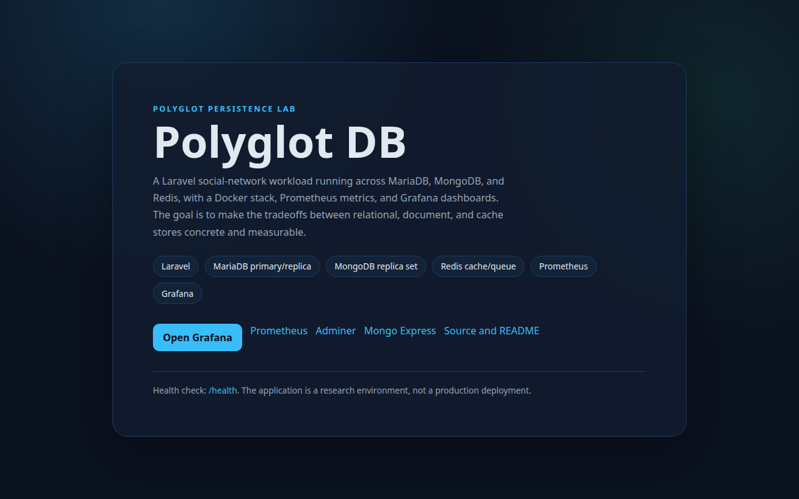
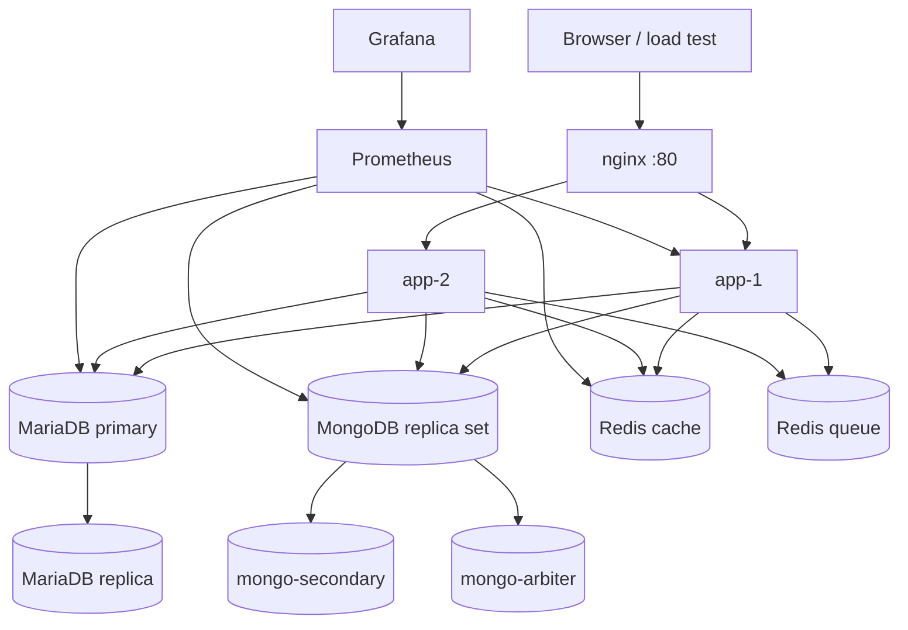

# Polyglot DB

A hands-on lab for polyglot persistence: one Laravel social-network workload
running on MariaDB, MongoDB, and Redis, with Docker, Prometheus, and Grafana.



[](https://github.com/Zeusse-Neumbi/polyglot-db/actions/workflows/ci.yml)
[](LICENSE)


## What this is

This repository is an infrastructure and observability project. It runs the same
application across two persistence models and exposes the result through
Prometheus and Grafana:

- **MariaDB** for relational data: users, roles, friendships, groups, pages, and
  conversations.
- **MongoDB** for document-shaped data: posts, comments, reactions, messages,
  notifications, and session audits.
- **Redis** for cache and queues, split into separate instances.
- **nginx** in front of two Laravel containers for round-robin load balancing.
- **Prometheus + Grafana** for application, database, container, and host
  metrics.

> **Status: lab, not a finished comparative study.** The polyglot stack, seeders,
> traffic simulator, and dashboards are implemented. The single-database
> baseline and benchmark results are the next phase. See
> [`docs/benchmark-plan.md`](docs/benchmark-plan.md).

## Architecture



More detail: [`docs/architecture.md`](docs/architecture.md).

## Implemented

- Laravel model layer for the relational and document stores.
- 13 migrations for the relational schema, plus Eloquent models for the MongoDB
  collections.
- Factories and modular seeders for users, friendships, posts, comments,
  reactions, groups, pages, conversations, messages, notifications, and session
  audits.
- Docker Compose stack with:
  - nginx load balancer
  - two Laravel app containers
  - queue worker
  - MariaDB primary/replica
  - MongoDB replica set with an arbiter
  - separate Redis cache and queue instances
  - Prometheus, Grafana, cAdvisor, node-exporter, and database exporters
  - Portainer, Adminer, and Mongo Express
- Four provisioned Grafana dashboards: business analytics, database comparison,
  Docker monitoring, and host monitoring.
- `traffic:simulate` command with a power-law user distribution and realistic
  action mix.
- Pest test harness with a health endpoint and opt-in live database checks.

## Not implemented yet

- A single-database baseline (`docker-compose.simple.yml`).
- A committed benchmark harness and published results.
- A production authentication/UI flow; the app is a workload and infrastructure
  test bed, not a finished social network.
- TLS, backups, and production secrets management.

## Quick start

Requirements: Docker Engine with Compose v2, at least 4 GB of RAM available to
Docker, and ports 80, 3000, 3308–3309, 6381–6382, 8081–8082, 9000, 9099, and
27020–27022 free.

```bash
git clone https://github.com/Zeusse-Neumbi/polyglot-db.git
cd polyglot-db

cp .env.docker.example .env.docker
bash docker/scripts/start.sh
```

`start.sh` builds the images, starts the stack, initializes the MongoDB replica
set, configures MariaDB replication, runs migrations, and caches config/routes.

Seed a small demo dataset (choose **Small — 1,000 users** on the first run):

```bash
docker compose exec app-1 php artisan db:seed
```

Run the traffic simulator for 60 seconds with 20% of users active:

```bash
docker compose exec app-1 php artisan traffic:simulate \
  --duration=60 --active-percent=20
```

## Access points

| Service | URL / port |
| --- | --- |
| Application | <http://localhost> |
| Grafana | <http://localhost:3000> (`admin` / `admin`) |
| Prometheus | <http://localhost:9099> |
| Portainer | <http://localhost:9000> |
| Adminer | <http://localhost:8081> |
| Mongo Express | <http://localhost:8082> (`admin` / `pass`) |
| MariaDB primary | `localhost:3308` |
| MariaDB replica | `localhost:3309` |
| MongoDB primary | `localhost:27020` |
| Redis cache | `localhost:6381` |
| Redis queue | `localhost:6382` |

Health check: <http://localhost/health>.

## Observability

Prometheus scrapes the app containers, MariaDB, MongoDB, Redis, cAdvisor, and
node-exporter. Grafana is provisioned from
[`docker/grafana/dashboards`](docker/grafana/dashboards):

- **Business analytics** — users, posts, comments, reactions, messages.
- **Database comparison** — MariaDB vs MongoDB activity and latency.
- **Docker monitoring** — per-container CPU, memory, network, and restarts.
- **Host monitoring** — CPU, memory, disk, and load.

Open Grafana after the stack is healthy. Dashboards are provisioned
automatically; no manual import is required.

## Tests

The default suite uses in-memory SQLite and does not need the Docker stack:

```bash
composer install
cp .env.example .env
php artisan key:generate
php artisan test
```

The live database checks are opt-in:

```bash
RUN_DB_INTEGRATION_TESTS=1 php artisan test --filter=DatabaseConnectionTest
```

Run that command only while the Docker stack is up; it expects MariaDB, MongoDB,
and Redis on the ports documented above.

## Project layout

```text
app/                    Laravel models, services, commands
config/                 Database, queue, cache, and app configuration
database/
  migrations/           Relational schema
  seeders/              Modular, resumable demo data
docker/
  app/                  PHP-FPM image
  grafana/              Provisioned dashboards and datasources
  mariadb/              Primary/replica configuration
  prometheus/           Scrape configuration
  scripts/              Start and status helpers
docs/                   Architecture and benchmark plan
tests/                  Unit, feature, and opt-in integration tests
```

## Design notes

- **Two stores, one domain.** The split is deliberate: relational integrity for
  identity and relationships, document storage for feed-shaped data. The extra
  complexity is the subject of the lab, not an accident.
- **Separate Redis instances.** Cache and queue traffic have different eviction
  and latency requirements; sharing one instance would hide that tradeoff.
- **The startup script is idempotent.** Re-running it tolerates an initialized
  replica set and existing replication configuration.
- **Monitoring is part of the implementation.** A stack that cannot show its own
  latency and resource use cannot support a performance claim.
- **No benchmark claim without a harness.** The README will not claim a speedup
  until the baseline and results are committed.

## Limitations

- Development credentials are in `docker/` and `.env.docker.example`; they are
  not production secrets.
- The app is not a finished product; the primary user-facing route is a landing
  page and `/health`.
- The benchmark has not been run, so no performance conclusion is claimed.
- The stack is resource-heavy by design and intended for a local workstation.

## License

[MIT](LICENSE) © 2026 Neumbi Kemgang Zeusse
