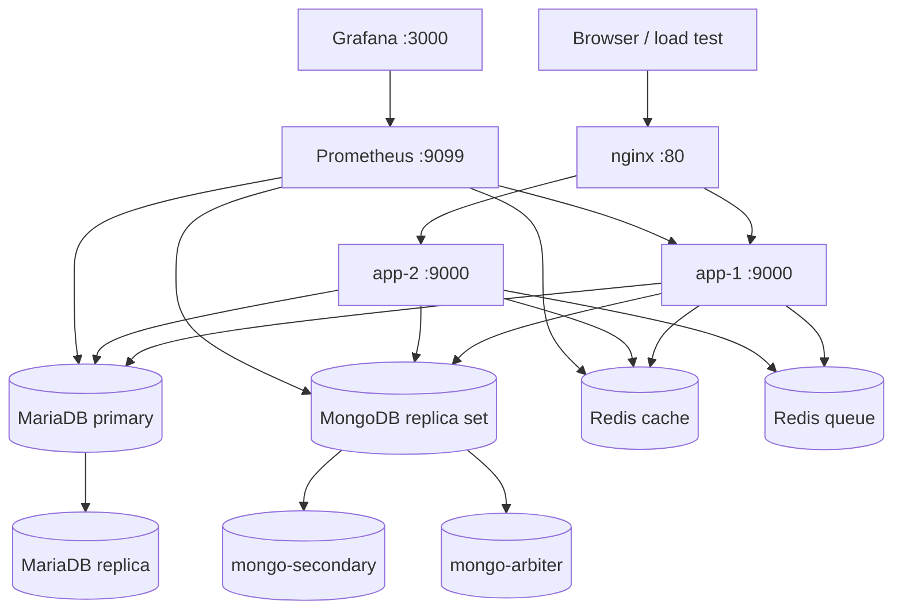

# Architecture

Polyglot DB is a local research environment for comparing persistence choices on
one Laravel workload. It is intentionally more infrastructure than a normal
starter app: the point is to see how relational, document, cache, and queue
stores behave together.

## Component map

## Responsibilities

| Component | Responsibility |
| --- | --- |
| `nginx` | Single entry point and round-robin load balancer across two app containers. |
| `app-1`, `app-2` | Laravel application; same image, separate instances. |
| `queue-worker` | Redis-backed queue worker for background jobs. |
| `mariadb-primary` | Writes and relational data: users, roles, friendships, groups, pages, conversations. |
| `mariadb-replica` | Read replica for the relational workload. |
| `mongo-primary`, `mongo-secondary`, `mongo-arbiter` | Replica set for document data: posts, comments, reactions, messages, notifications, session audits. |
| `redis-cache` | Application cache and sessions. |
| `redis-queue` | Queue backend, isolated from the cache. |
| `prometheus` | Scrapes application, MariaDB, MongoDB, Redis, and host metrics. |
| `grafana` | Four provisioned dashboards: business analytics, database comparison, Docker monitoring, host monitoring. |
| `portainer` | Container and network visibility. |
| `adminer`, `mongo-express` | Lightweight database browsers. |

## Data split

The application deliberately uses two persistence models:

- **MariaDB** owns data with strong relational constraints: users, roles,
  friendships, groups, pages, conversations, and membership tables.
- **MongoDB** owns high-volume, document-shaped data: posts, comments, reactions,
  messages, notifications, and session audit events.

The Eloquent models use `mongodb/laravel-mongodb` for the document side and
Laravel's MariaDB connection for the relational side. The split is a design
choice to make the tradeoffs visible, not a claim that every social network
should use both stores.

## Startup flow

`docker/scripts/start.sh` performs the orchestration that Compose cannot express
alone:

1. Check that Docker is running.
2. Build and start the stack.
3. Initialize the MongoDB replica set with `rs.initiate()`.
4. Configure MariaDB primary-to-replica replication.
5. Run Laravel migrations.
6. Generate the application key and cache configuration/routes.

The script is idempotent: it tolerates an already-initialized replica set and
already-configured replication.

## Operational notes

- **Replication user creation order matters.** The primary initialization script
  creates the `laravel` user before granting privileges. Granting a user that
  does not exist breaks the replication stream.
- **Mounted volumes and container permissions differ.** If the app returns a
  permission error on `storage` or `bootstrap/cache`, fix ownership in the app
  container rather than loosening permissions globally.
- **Redis is split on purpose.** A queue backlog should not evict the cache or
  affect session reads.
- **The stack is for local experimentation.** It uses development credentials,
  no TLS, and no backup policy. Do not deploy it as-is.

## Access points

| Service | URL / port |
| --- | --- |
| Application | <http://localhost> |
| Grafana | <http://localhost:3000> (`admin` / `admin`) |
| Prometheus | <http://localhost:9099> |
| Portainer | <http://localhost:9000> |
| Adminer | <http://localhost:8081> |
| Mongo Express | <http://localhost:8082> (`admin` / `pass`) |
| MariaDB primary | `localhost:3308` |
| MariaDB replica | `localhost:3309` |
| MongoDB primary | `localhost:27020` |
| Redis cache | `localhost:6381` |
| Redis queue | `localhost:6382` |

## Benchmark status

The comparative benchmark is **not implemented yet**. The current repository
proves that the polyglot stack works and is observable; it does not yet prove
that it is faster or slower than a single-database baseline. See
[benchmark-plan.md](benchmark-plan.md) for the planned methodology.
